# Task 1 — Log Collection & Ingestion

## Objective
Set up a centralized log collection pipeline using **Splunk Enterprise** on Windows Server 2022 as the SIEM server, and **Splunk Universal Forwarder** on Ubuntu/Kali Linux as the log source endpoint.

---

## 1.1 — Launch Windows Server 2022 VM
1. Open **Oracle VirtualBox** or **VMware Workstation** from your desktop or Start menu
2. In the left panel, locate and click on the VM named `01-windows server 2022`
3. This VM will act as your **SIEM server** where Splunk Enterprise is installed

---

## 1.2 — Configure Network Adapter to Host-Only
1. With the Windows Server VM selected, click **Settings → Network**
2. Go to the **Adapter 2** tab
3. Tick **Enable Network Adapter**
4. In the **Attached to** dropdown, select **Host-only Adapter**

> This ensures the VM communicates only with your host machine and other VMs, creating a secure and isolated lab network.

---

## 1.3 — Save Settings
1. Click **OK** at the bottom of the Settings window

> Without saving, the VM will not use the new Host-only network configuration.

---

## 1.4 — Start Windows Server VM
1. Select the VM and click the **Start** button (green arrow)
2. Wait for Windows Server 2022 to fully boot up before proceeding

---

## 1.5 — Access Splunk Website
1. Open a browser inside the Windows Server VM
2. Navigate to [splunk.com](https://www.splunk.com) → **Trials & Downloads**

> This is where you will download Splunk Enterprise for installation on the SIEM server.

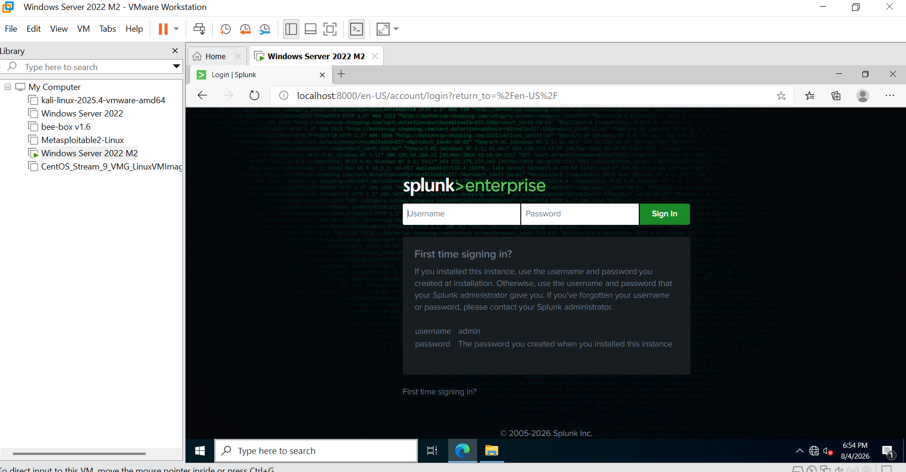

---

## 1.6 — Create and Verify Splunk Account
1. Click **Start free trial**
2. Fill in the required registration fields
3. Check your inbox and click the verification link sent to your email

> Splunk requires a verified account before allowing any downloads.

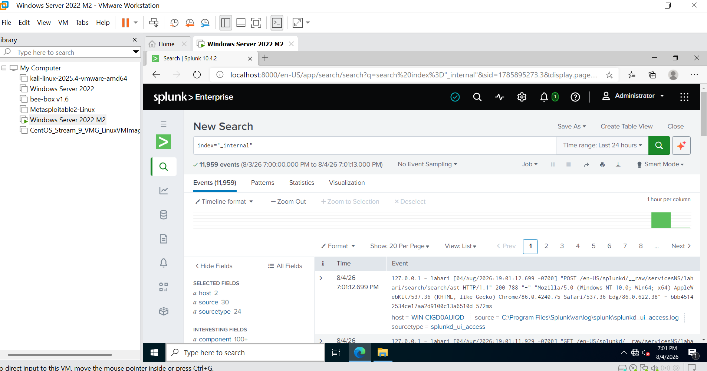

---

## 1.7 — Download Splunk Enterprise for Windows
1. Log in to your Splunk account
2. Go to the **Windows** tab
3. Click **Download Now** to download the installer

> This installs Splunk Enterprise on your Windows Server VM, turning it into the SIEM platform.

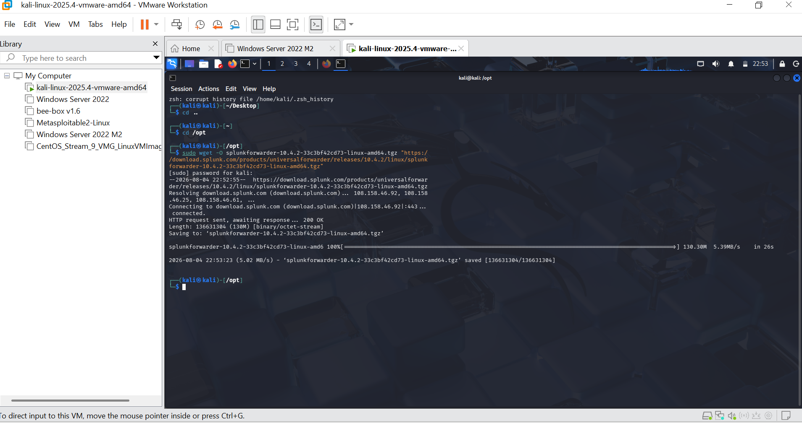

---

## 1.8 — Install and Verify Splunk Enterprise
1. Run the downloaded installer and follow the setup wizard
2. During installation, set your **username** and **password** — note these down
3. Once installed, open Splunk Web in the browser at `http://localhost:8000`
4. Log in with the credentials you created during installation
5. Go to **Search & Reporting** and run the following test search:
```
index="_internal"
```
6. Press **Enter** — you should see results from Splunk's own system logs confirming it is working

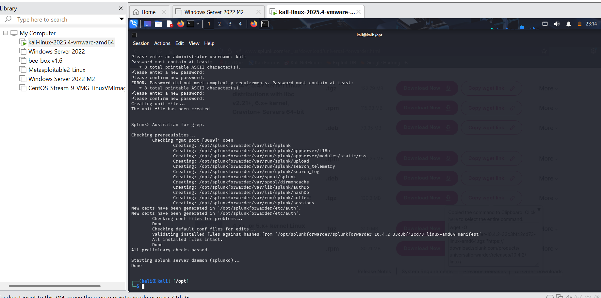

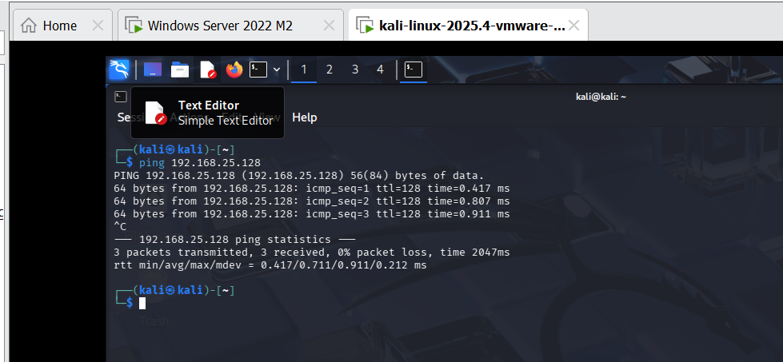

---

## 1.9 — Open Chrome in Ubuntu/Kali VM
1. Switch to your **Ubuntu/Kali Linux** machine
2. Launch the **Chrome** or **Firefox** browser
3. You will use this to download the Splunk Universal Forwarder

---

## 1.10 — Download Splunk Universal Forwarder
1. Search for **Download Splunk Universal Forwarder for Linux**
2. Click the official Splunk link
3. Select the **64-bit .tgz** package and copy the **wget** download link

> The Splunk Forwarder ships logs from the Linux machine to Splunk Enterprise on Windows.

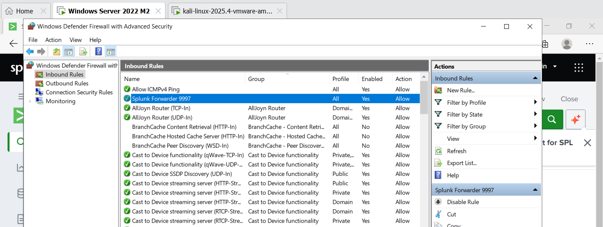

---

## 1.11 — Navigate to /opt Directory
1. Open a **Terminal** in Ubuntu/Kali
2. Run:
```bash
cd /opt
```

> `/opt` is the standard Linux location for installing third-party software.

---

## 1.12 — Download via wget
1. Paste the wget link you copied and prefix it with `sudo`:
```bash
sudo wget <copied_link>
```

> The file will download directly into `/opt`.

---

## 1.13 — Verify the Download
1. List the files in `/opt` to confirm the download:
```bash
ls
```
2. You should see the `.tgz` file present

---

## 1.14 — Extract the Package
1. Unpack the Splunk Forwarder archive:
```bash
sudo tar -xvzf splunkforwarder-<version>.tgz
```
2. This creates a folder named `splunkforwarder` containing all binaries and config files

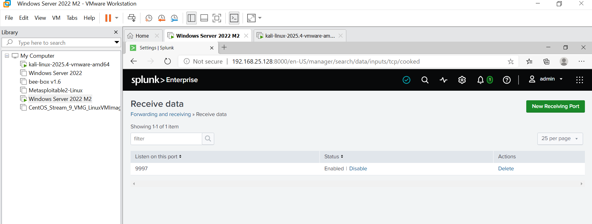

---

## 1.15 — Start Splunk Forwarder
1. Start the forwarder service for the first time:
```bash
sudo ./splunkforwarder/bin/splunk start --accept-license
```
2. Accept the license terms when prompted
3. Set the admin username: `admin`
4. Set the password: `Admin@123` (enter twice to confirm)

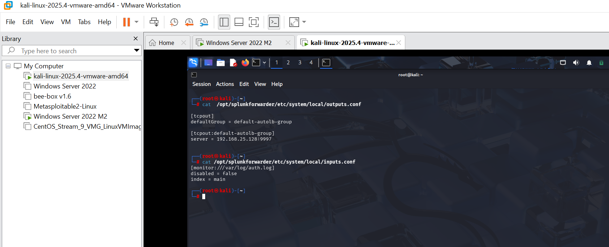

---

## 1.16 — Get Windows Server IP Address
1. On the **Windows Server VM**, open Command Prompt and run:
```cmd
ipconfig
```
2. Look for the **Host-only adapter** — note the IP address (e.g., `192.168.25.128`)
3. This is the address the Splunk Forwarder will send logs to
4. Verify connectivity from Kali to the Splunk server by pinging this IP

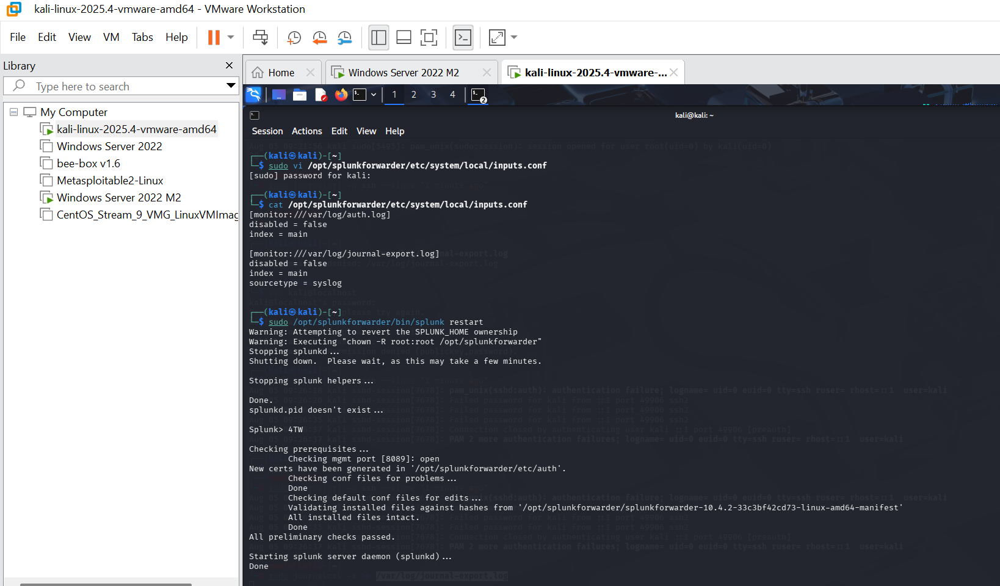

---

## 1.17 — Access Splunk Web on Windows Server
1. On the Windows Server VM, open a browser and navigate to:
```
http://192.168.25.128:8000
```
2. Log in with your Splunk admin credentials

> This is Splunk's web interface where you configure data ingestion and monitor incoming logs.

---

## 1.18 — Configure Splunk Enterprise to Receive Logs

### On Splunk Enterprise (Windows Server):
1. Go to **Settings → Forwarding & Receiving**
2. Under **Receive Data**, click **Configure Receiving**
3. Click **New Receiving Port** and enter `9997`
4. Click **Save**
5. Confirm that **Windows Firewall** allows inbound traffic on port `9997`

### On Kali/Ubuntu — Configure outputs.conf:
1. Navigate to the Splunk Forwarder config directory:
```bash
cd /opt/splunkforwarder/etc/system/local
```
2. Edit `outputs.conf` to point to the Splunk Enterprise server:
```ini
[tcpout]
defaultGroup = splunk_indexer

[tcpout:splunk_indexer]
server = 192.168.25.128:9997
```

### Configure inputs.conf:
1. Edit `inputs.conf` to define the log sources to monitor:
```ini
[monitor:///var/log/auth.log]
disabled = false
index = main
sourcetype = syslog

[monitor:///var/log/syslog]
disabled = false
index = main
sourcetype = syslog

[monitor:///var/log/journal-export.log]
disabled = false
index = main
sourcetype = syslog
```

### Restart the Forwarder:
```bash
sudo ./splunkforwarder/bin/splunk restart
```

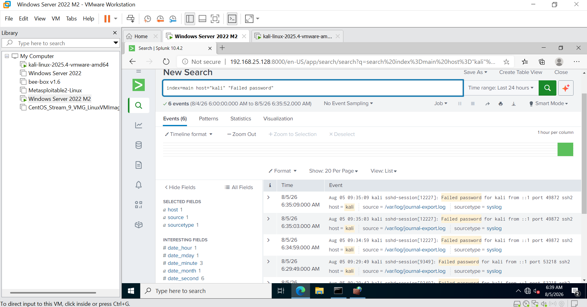

---

## 1.19 — Verify Data Flow

### Check forwarder connectivity on Kali:
```bash
cat /opt/splunkforwarder/var/log/splunk/splunkd.log | grep "Connected to idx"
```
You should see: `Connected to idx=192.168.25.128:9997`

### Verify in Splunk Web (Windows):
```
index=main host="kali"
```
Logs from the Kali machine should appear in the results.

---

## 1.20 — Generate and Verify Security Events

### Generate failed SSH login attempts on Kali:
```bash
ssh kali@localhost
# Enter the wrong password multiple times
```

### Confirm logs are written locally:
```bash
cat /var/log/auth.log | grep "Failed password"
```

### Search in Splunk Web to verify ingestion:
```
index=main host="kali" "Failed password"
```

You should see the failed login events appearing in Splunk.

### Save as a Report:
1. Click **Save As → Report**
2. Give the report a meaningful title (e.g., `Failed SSH Logins - Kali`)
3. Click **Save**

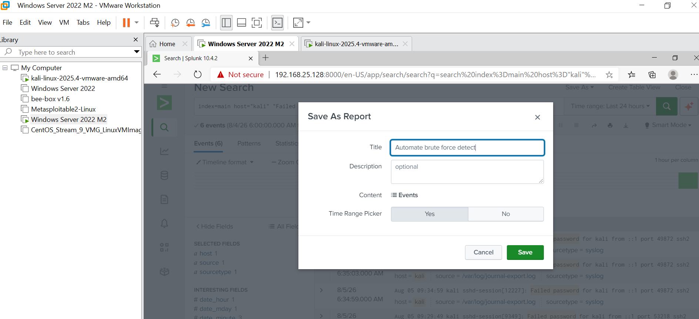
