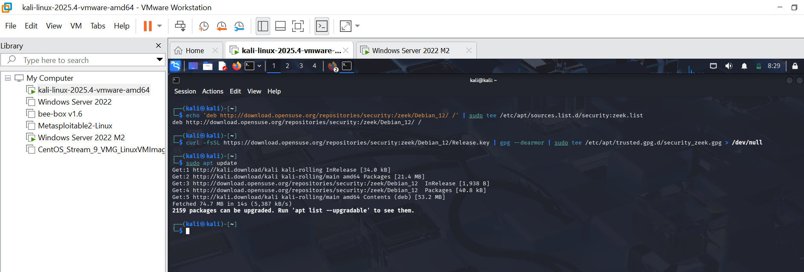
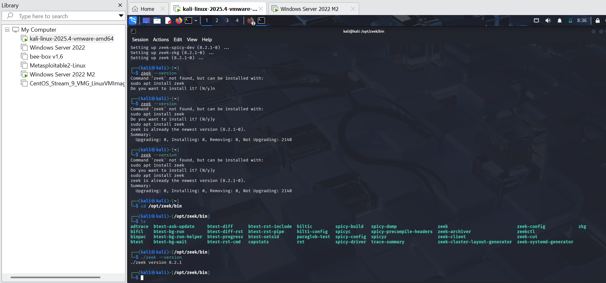
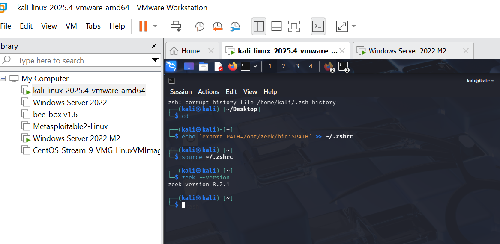

# Task 2 — AI-Driven Detection & Threat Intelligence

## Objective
Augment the SOC with **Zeek**, an open-source network traffic analyzer, to provide AI-driven threat intelligence by parsing network traffic into structured logs that feed into Splunk for correlation and anomaly detection.

---

## 2.1 — Update System Packages and Install Prerequisites
1. Open a **Terminal** on your Kali/Ubuntu machine
2. Update the package list and install required tools:
```bash
sudo apt update
sudo apt install curl gnupg -y
```

> Kali Linux usually comes with most tools pre-installed. Run this step to ensure `curl` and `gnupg` are available before adding the Zeek repository.

---

## 2.2 — Understand Why Zeek is Needed
Zeek is a powerful network security monitoring tool that:
- Captures and parses **live network traffic** into structured logs
- Generates logs such as `conn.log`, `dns.log`, `http.log`, `ssl.log`
- Provides **threat intelligence** by detecting suspicious patterns in network behavior
- Complements Splunk's host-based log analysis with **network-level visibility**

---

## 2.3 — Navigate to the Zeek Website
1. Open **Chrome** or **Firefox** on your Kali machine
2. Navigate to [zeek.org](https://zeek.org)
3. Go to the **Get Zeek** or **Downloads** section for official installation instructions

> Always use the official source to avoid tampered or malicious binaries.



---

## 2.4 — Select Linux Binaries for Debian/Ubuntu
1. On the Zeek site, select **Linux Binaries**
2. Choose **Debian/Ubuntu** from the list

> Kali Linux is Debian-based, so the Ubuntu/Debian repository is fully compatible with Kali.

---

## 2.5 — Add the Zeek Repository
1. Add the official Zeek repository to your package manager:
```bash
echo 'deb http://download.opensuse.org/repositories/security:/zeek/Debian_11/ /' | \
  sudo tee /etc/apt/sources.list.d/security:zeek.list
```

> This tells `apt` where to find and download Zeek packages. Without this step, `apt` will not know where to fetch Zeek.

---

## 2.6 — Add the GPG Key
1. Import the GPG key to verify the authenticity of Zeek packages:
```bash
curl -fsSL https://download.opensuse.org/repositories/security:zeek/Debian_12/Release.key | \
  gpg --dearmor | \
  sudo tee /etc/apt/trusted.gpg.d/security_zeek.gpg > /dev/null
```

> The GPG key ensures that the packages you download are genuine and have not been tampered with.

---

## 2.7 — Update the Package List
1. Refresh the package list to include the newly added Zeek repository:
```bash
sudo apt update
```

---

## 2.8 — Install Zeek
1. Install Zeek using apt:
```bash
sudo apt install zeek -y
```
2. Once installed, navigate to the Zeek binary directory:
```bash
cd /opt/zeek/bin
```

---

## 2.9 — Verify Zeek Installation
1. Check the installed version of Zeek:
```bash
./zeek --version
```
2. You should see output showing the Zeek version number confirming a successful installation



---

## 2.10 — Add Zeek to PATH Permanently
1. Open a **new terminal** and add Zeek to your shell PATH so it can be run from anywhere:
```bash
echo 'export PATH=/opt/zeek/bin:$PATH' >> ~/.zshrc
source ~/.zshrc
```
2. Verify Zeek is accessible globally:
```bash
zeek --version
```

> Adding Zeek to PATH means you no longer need to navigate to `/opt/zeek/bin` every time you want to run it.



---

## What Zeek Provides to the SOC

| Log File | What it captures |
|----------|-----------------|
| `conn.log` | All network connections (IP, port, duration, bytes) |
| `dns.log` | DNS queries and responses |
| `http.log` | HTTP requests and responses |
| `ssl.log` | SSL/TLS certificate details |
| `weird.log` | Unusual or anomalous network activity |

These logs are forwarded to Splunk via the Universal Forwarder, enabling:
- **Correlation** of network events with host-based logs
- **Detection** of C2 communication, port scans, and data exfiltration
- **Threat hunting** using network-level IOCs
