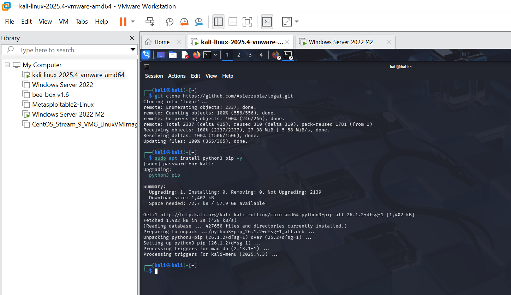
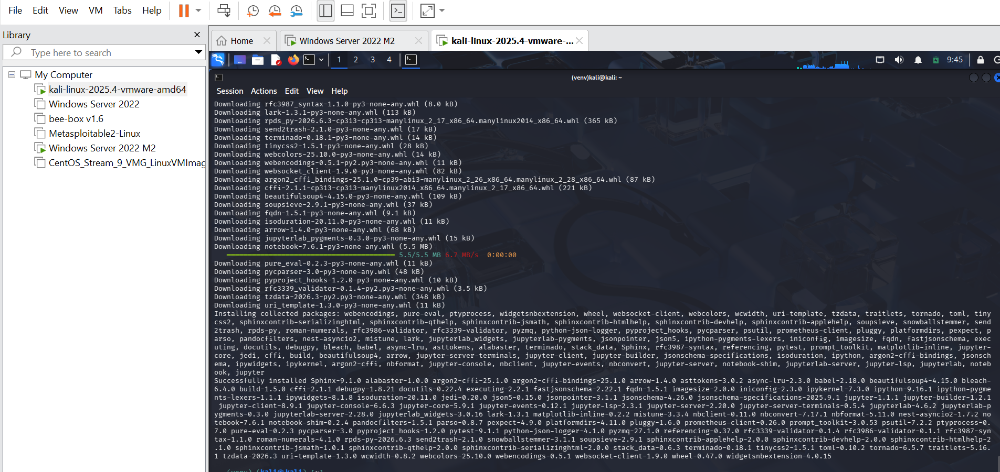
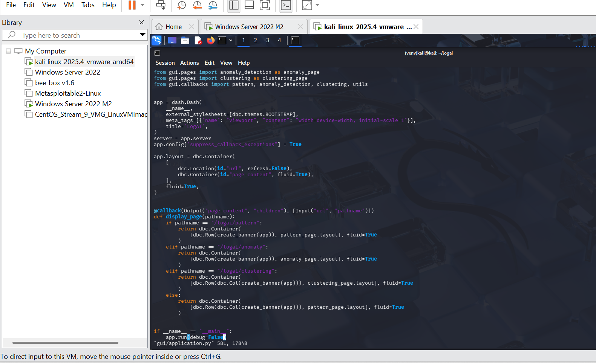
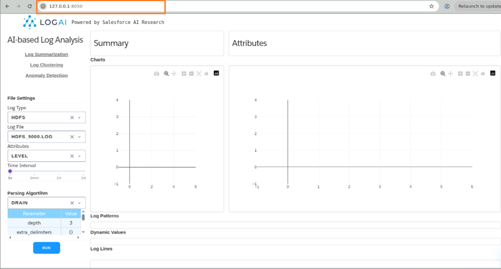
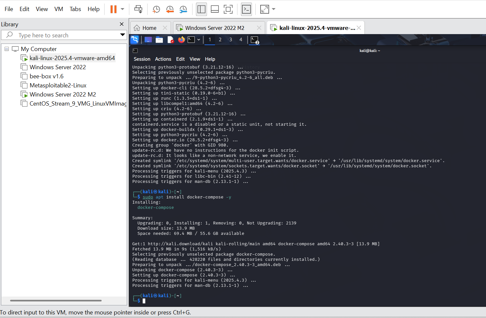
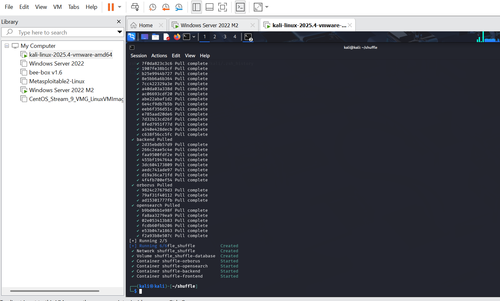

# Task 3 — Threat Hunting & IOC Pivoting with LogAI

## Objective
Use **LogAI** — an open-source AI-powered log analysis tool — to detect anomalies in ingested logs and pivot on Indicators of Compromise (IOCs) to identify potential threats within the SOC environment.

---

## What is LogAI?
LogAI is an AI-driven log analysis framework that:
- Detects **anomalies** in log data using machine learning models
- Enables **IOC pivoting** — correlating log entries with known threat indicators
- Provides a **visual GUI dashboard** for interactive log exploration
- Supports log formats from Splunk, Zeek, syslog, and more

---

## 3.1 — Clone the LogAI Repository
1. Open a **Terminal** on your Kali/Ubuntu machine
2. Clone the LogAI repository from GitHub:
```bash
git clone https://github.com/Asierzubia/logai.git
```

> This downloads the LogAI source code locally. You need the repository to install and run the tool.



---

## 3.2 — Install pip (Python Package Manager)
1. Install pip if it is not already available:
```bash
sudo apt install python3-pip -y
```

> pip is required to install LogAI and all its dependencies.

---

## 3.3 — Create a Python Virtual Environment
1. Create an isolated Python environment to avoid conflicts with system packages:
```bash
python3 -m venv venv
```
2. Activate the virtual environment:
```bash
source venv/bin/activate
```

> You should see `(venv)` appear at the beginning of your terminal prompt, confirming the environment is active.

---

## 3.4 — Install the Core LogAI Package
1. Install the base LogAI package:
```bash
pip install logai
```

> This installs the core LogAI library for log anomaly detection.

---

## 3.5 — Install LogAI GUI Dependencies
1. Install the GUI extras for the visual dashboard:
```bash
pip install "logai[gui]"
```





---

## 3.9 — Install LogAI Dev Dependencies
1. Install the development dependencies:
```bash
pip install "logai[dev]"
```

> The dev package includes additional libraries needed for running the full LogAI feature set.

---

## 3.10 — Navigate to the LogAI Directory
1. Change into the cloned LogAI directory:
```bash
cd logai
```

---

## 3.11 — Open the application.py File
1. Open the GUI application file using the nano text editor:
```bash
nano gui/application.py
```

---

## 3.12 — Patch application.py for Framework Compatibility
1. Scroll to the **very bottom** of the file
2. Locate the following line:
```python
app.run_server(debug=False)
```
3. Replace it with:
```python
app.run(debug=False)
```
4. Save and exit: press `Ctrl+X` → `Y` → `Enter`

> This change is required because newer versions of the Dash framework renamed `run_server()` to `run()`. Without this fix, the GUI will fail to start.



---

## 3.14 — Set the PYTHONPATH Environment Variable
1. Set the PYTHONPATH so Python can locate LogAI modules correctly:
```bash
export PYTHONPATH=.
```

> Without this, Python may throw `ModuleNotFoundError` when trying to import LogAI components.

---

## 3.15 — Launch the LogAI GUI
1. Start the LogAI application:
```bash
python3 gui/application.py
```
2. Wait for the server to start — you will see output indicating it is running on port `8050`



---

## 3.16 — Access the LogAI Dashboard
1. Open **Chrome** or **Firefox** on the same machine
2. Navigate to:
```
http://127.0.0.1:8050
```
3. The LogAI dashboard will load in the browser



---

## What the LogAI Dashboard Provides

| Feature | Description |
|---------|-------------|
| **Log Anomaly Detection** | Identifies unusual patterns in ingested log data using AI models |
| **IOC Pivoting** | Correlates log entries with known threat indicators (IPs, hashes, domains) |
| **Clustering** | Groups similar log events together to surface patterns |
| **Timeline View** | Visualizes log events over time to identify spikes or gaps |
| **Log Summarization** | Condenses large volumes of logs into meaningful summaries |

---

## How to Use LogAI for Threat Hunting
1. Upload or point LogAI to your Splunk-exported log files
2. Select an **anomaly detection model** from the dashboard
3. Run the analysis — LogAI will highlight anomalous log entries
4. Use the **IOC pivot** feature to cross-reference flagged entries with threat intelligence feeds
5. Export findings for inclusion in your incident report
