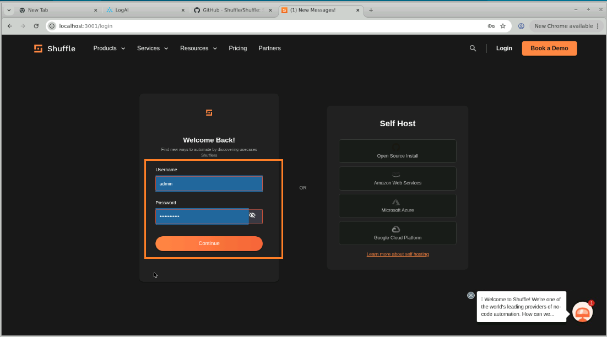
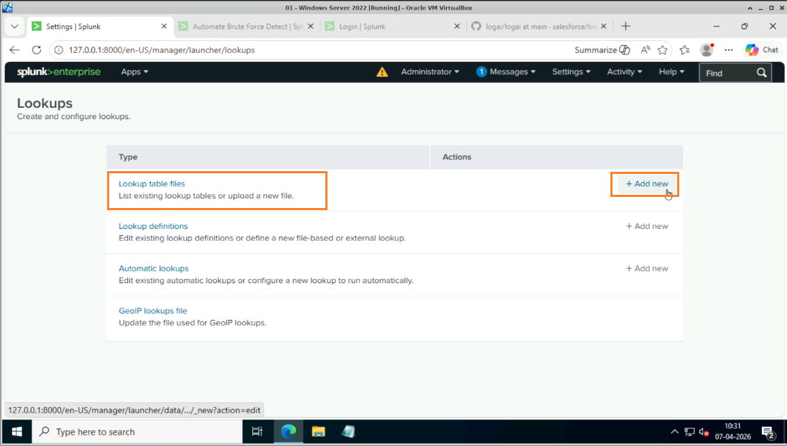
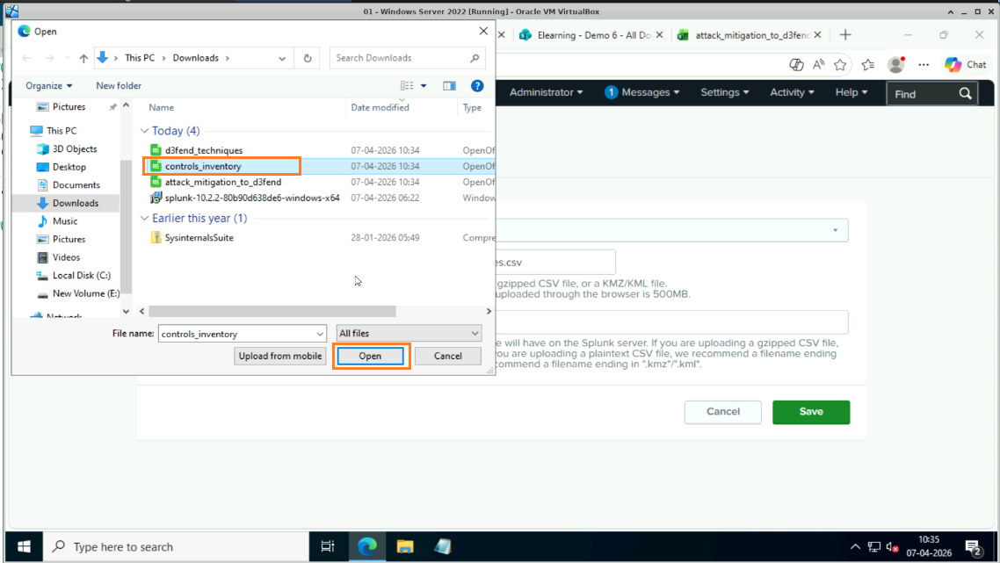
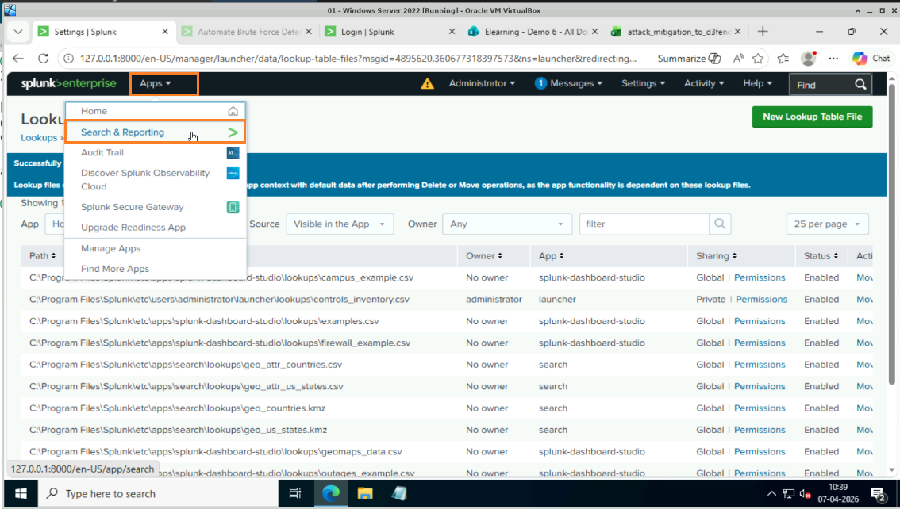
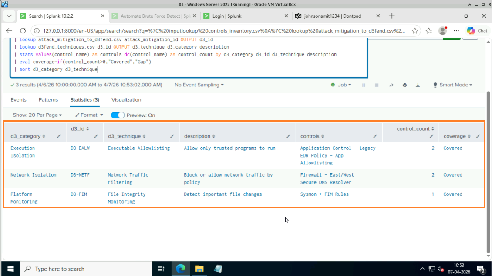
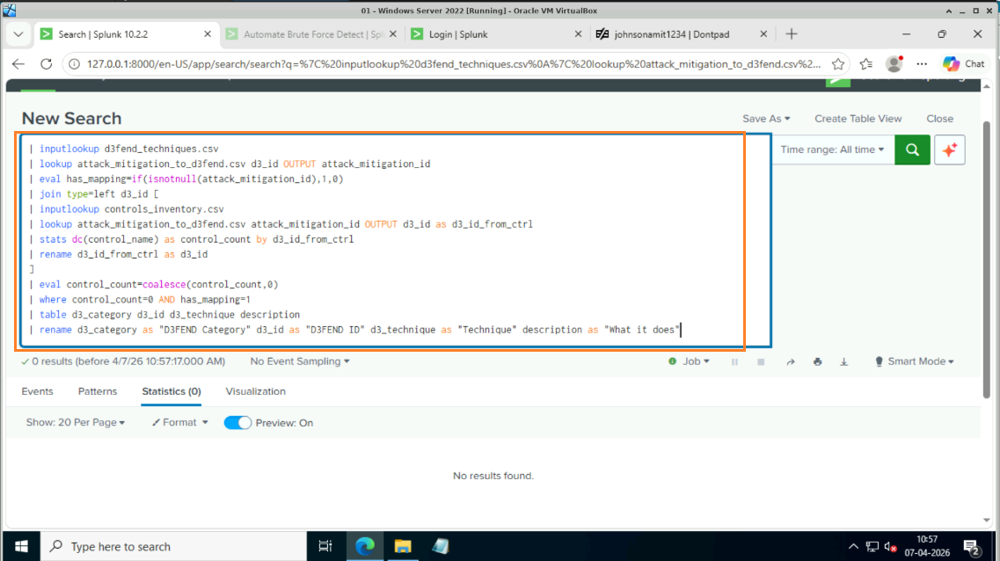
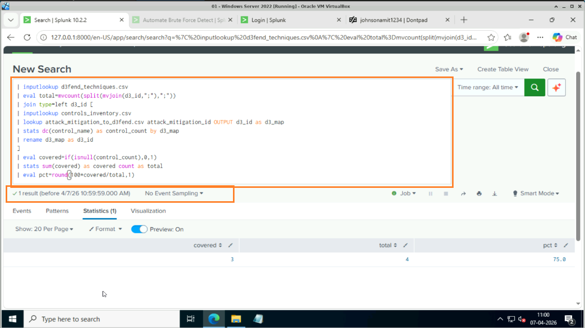
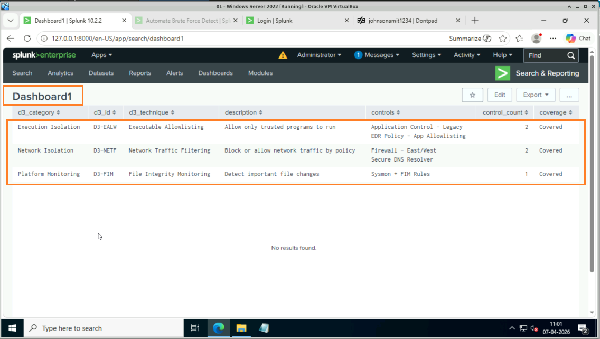
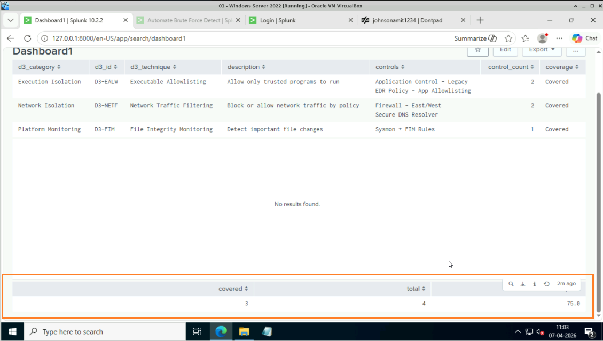

# Task 4 — SOAR Automation & MITRE D3FEND Gap Analysis

## Objective
Automate security operations using **Shuffle SOAR**, and perform security control mapping and gap analysis by correlating existing defenses with the **MITRE D3FEND** framework to identify coverage gaps and prioritize missing controls.

---

## What is Shuffle SOAR?
Shuffle is an open-source **Security Orchestration, Automation, and Response (SOAR)** platform that:
- Acts as a **workflow engine** for security operations
- Connects tools like Splunk, Zeek, and LogAI into automated playbooks
- Automates responses such as blocking IPs, sending alerts, and creating tickets
- Eliminates the need to manually react to every security alert

---

## 4.1 — Install Docker
1. Open a **Terminal** on your Kali/Ubuntu machine
2. Install Docker:
```bash
sudo apt install docker.io -y
```

> Docker is a containerization tool. Shuffle runs inside Docker containers, making deployment easy and isolated without affecting your Kali system.

---

## 4.2 — Install Docker Compose
1. Install Docker Compose to manage Shuffle's multi-container setup:
```bash
sudo apt install docker-compose -y
```

> Shuffle requires multiple containers (backend, frontend, database). Docker Compose orchestrates all of them with a single command.

---

## 4.3 — Verify Docker Installation
1. Confirm both tools are installed correctly:
```bash
docker --version
docker-compose --version
```



---

## 4.4 — Clone the Shuffle Repository
1. Clone Shuffle's source code from GitHub:
```bash
git clone https://github.com/frikky/shuffle
```
2. Navigate into the cloned directory:
```bash
cd shuffle
```

> You need the repository to run Shuffle locally. It contains the Docker Compose configuration and all required files.

---

## 4.5 — Start Shuffle with Docker Compose
1. Launch all Shuffle containers in the background:
```bash
sudo docker-compose up -d
```

> The `-d` flag runs the containers in detached (background) mode. This starts the web interface, backend API, and database simultaneously.



---

## 4.6 — Verify Running Containers
1. List all active Docker containers to confirm Shuffle is running:
```bash
sudo docker ps
```
2. You should see the following containers active:
   - `shuffle-backend`
   - `shuffle-frontend`
   - `shuffle-database` (or `opensearch`)



---

## 4.7 — Access the Shuffle Dashboard
1. Open a browser and navigate to:
```
http://127.0.0.1:3001
```
2. You will see the Shuffle login or signup page

---

## 4.11 — Verify Shuffle Admin Setup Page
1. Navigate to the admin setup URL to initialize Shuffle:
```
http://localhost:3001/adminsetup
```

---

## 4.12 — Create Administrator Account
1. Fill in the required fields to create your Shuffle admin account:
   - **Username**: choose an admin username
   - **Password**: choose a strong password
2. Click **Create Account**

---

## 4.13 — Log In to Shuffle
1. Use the credentials you just created to log in at:
```
http://localhost:3001
```
2. You will land on the Shuffle main dashboard where you can build playbooks



---

## 4.15 — Open Splunk on Windows Server
1. Switch to your **Windows Server VM**
2. Open a browser and navigate to Splunk Web:
```
http://192.168.25.128:8000
```
3. Log in with your Splunk admin credentials

---

## 4.16 — Navigate to Settings
1. In Splunk Web, click on **Settings** in the top navigation bar

---

## 4.17 — Navigate to Lookups
1. Under Settings, click on **Lookups**

---

## 4.18 — Add a New Lookup Table File
1. Under **Lookup table files**, click **+ Add new**

---

## 4.19 — Download the Required CSV Files
1. Download the lookup CSV files from the following link:
   [Download CSV Files](https://simplilearnsolution.sharepoint.com/:f:/s/Elearning/En4Q-E_UdK5AmJWMO-ZusUMBevKQwGtEDEurW1a6hOcjKA?e=flhvSF)
2. The folder contains three files:
   - `controls_inventory.csv`
   - `d3fend_techniques.csv`
   - `attack_mitigation_to_d3fend.csv`

---

## 4.20 — Upload controls_inventory.csv
1. Click **Choose File**
2. Select `controls_inventory.csv` from your downloads
3. Click **Open**

---

## 4.21 — Set Destination Filename and Save
1. In the **Destination filename** field, enter exactly:
```
controls_inventory.csv
```
2. Click **Save**



---

## 4.23 — Upload d3fend_techniques.csv
1. Click **+ Add new** again under Lookup table files
2. Click **Choose File** and select `d3fend_techniques.csv`
3. Set the **Destination filename** to:
```
d3fend_techniques.csv
```
4. Click **Save**

---

## 4.24 — Upload attack_mitigation_to_d3fend.csv
1. Click **+ Add new** again
2. Click **Choose File** and select `attack_mitigation_to_d3fend.csv`
3. Set the **Destination filename** to:
```
attack_mitigation_to_d3fend.csv
```
4. Click **Save**

> All three CSV files are now available as lookup tables in Splunk for the gap analysis queries.

---

## 4.25 — Navigate to Search & Reporting
1. Click on **Apps** in the top navigation
2. Select **Search & Reporting** from the dropdown menu

---

## 4.26 — Map Controls and Check Coverage
1. Enter the following SPL query in the search bar:
```spl
| inputlookup controls_inventory.csv
| lookup attack_mitigation_to_d3fend.csv attack_mitigation_id OUTPUT d3_id
| lookup d3fend_techniques.csv d3_id OUTPUT d3_technique d3_category description
| stats values(control_name) as controls dc(control_name) as control_count by d3_category d3_id d3_technique description
| eval coverage=if(control_count>0,"Covered","Gap")
| sort d3_category d3_technique
```
2. Click **Search** (or press Enter)
3. Review the results — each row shows a D3FEND technique and whether it is **Covered** or a **Gap**



### Save as a New Dashboard:
1. Click **Save As → New Dashboard**
2. Enter the Dashboard Title: `Dashboard1`
3. Click **Save to Dashboard**

---

## 4.29 — Find Unmapped D3FEND Techniques
1. Enter the following SPL query to identify D3FEND techniques with no security controls mapped:
```spl
| inputlookup d3fend_techniques.csv
| lookup attack_mitigation_to_d3fend.csv d3_id OUTPUT attack_mitigation_id
| eval has_mapping=if(isnotnull(attack_mitigation_id),1,0)
| join type=left d3_id [
    | inputlookup controls_inventory.csv
    | lookup attack_mitigation_to_d3fend.csv attack_mitigation_id OUTPUT d3_id as d3_id_from_ctrl
    | stats dc(control_name) as control_count by d3_id_from_ctrl
    | rename d3_id_from_ctrl as d3_id
  ]
| eval control_count=coalesce(control_count,0)
| where control_count=0 AND has_mapping=1
| table d3_category d3_id d3_technique description
| rename d3_category as "D3FEND Category" d3_id as "D3FEND ID" d3_technique as "Technique" description as "What it does"
```
2. Click **Search** — the results show all D3FEND techniques that have no corresponding security controls



### Save to Existing Dashboard:
1. Click **Save As → Existing Dashboard**
2. Select **Dashboard1** from the dropdown
3. Click **Save to Dashboard**

---

## 4.32 — Calculate Overall Coverage Percentage
1. Enter the following SPL query to calculate what percentage of D3FEND techniques are covered:
```spl
| inputlookup d3fend_techniques.csv
| eval total=mvcount(split(mvjoin(d3_id,";"),";"))
| join type=left d3_id [
    | inputlookup controls_inventory.csv
    | lookup attack_mitigation_to_d3fend.csv attack_mitigation_id OUTPUT d3_id as d3_map
    | stats dc(control_name) as control_count by d3_map
    | rename d3_map as d3_id
  ]
| eval covered=if(isnull(control_count),0,1)
| stats sum(covered) as covered count as total
| eval pct=round(100*covered/total,1)
```
2. Click **Search** — the result shows the overall coverage percentage



### Save to Existing Dashboard:
1. Click **Save As → Existing Dashboard**
2. Select **Dashboard1** from the dropdown
3. Click **Save to Dashboard**
4. Click **View Dashboard** to see all three panels together



---

## Conclusion

By completing all four tasks, you have built a fully functional **AI-augmented SOC** pipeline:

| Task | What was achieved |
|------|------------------|
| **Task 1** | Centralized log ingestion from Linux and Windows endpoints into Splunk |
| **Task 2** | Network traffic analysis and threat intelligence using Zeek |
| **Task 3** | AI-powered log anomaly detection and IOC pivoting using LogAI |
| **Task 4** | Automated incident response with Shuffle SOAR + MITRE D3FEND gap analysis |

The gap analysis dashboard provides a clear picture of which D3FEND defensive techniques are covered by existing controls and which areas need investment — enabling data-driven security prioritization.
