# 🛠️ Full Setup Guide — Honeypot Deployment

## Prerequisites

- VMware Workstation Pro installed on Windows host
- CentOS Stream 9 VM image (`.vmx` + `.vmdk`)
- Kali Linux VM
- Both VMs configured on NAT network

---

## Step 1 — CentOS VM Setup in VMware

### 1.1 Download & Import CentOS

1. Go to the CentOS Stream 9 VM images page
2. Select **VMware Image (Graphical Installation)** and download the `.7z` file
3. Extract using **7-Zip** → you'll get `.vmx` and `.vmdk` files
4. Open VMware Workstation → **File → Open** → select the `.vmx` file
5. VMware registers it as a new VM named "CentOS Stream 9"

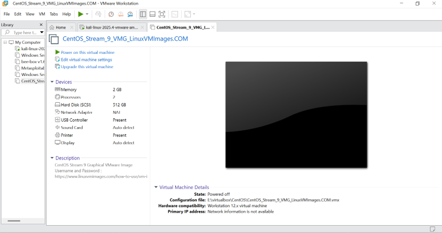

### 1.2 Configure Networking

1. Right-click the CentOS VM → **Settings → Network Adapter**
2. Select **NAT** — both Kali and CentOS must be on NAT so they can communicate

### 1.3 Start & Verify Connectivity

```bash
# On CentOS — check IP address
ip a

# On Kali — verify connectivity
ping <CentOS_IP>
```

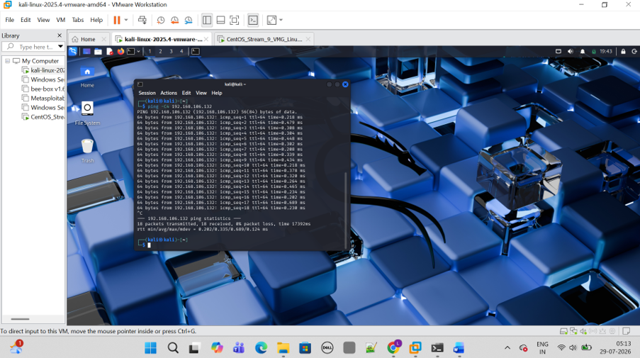


---

## Step 2 — Install Core Services on CentOS

```bash
# Switch to root
sudo su -

# Update system packages
yum update -y
```

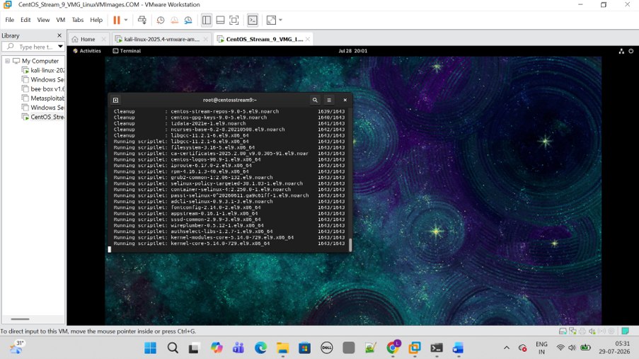

```bash
# Install all required services
yum install openssh-server -y
yum install vsftpd -y
yum install httpd -y
yum install whois -y

# Create reports directory
mkdir /Reports
```

### 2.1 Configure Fake Apache Website

```bash
# Create virtual host config
vi /etc/httpd/conf.d/testsite.mydomain.local.conf
```

Paste the following:

```apache
<VirtualHost *:80>
    ServerName testsite.mydomain.local
    DocumentRoot /var/www/testsite.mydomain.local
    <Directory /var/www/testsite.mydomain.local>
        Options Indexes FollowSymLinks
        AllowOverride None
        Require all granted
    </Directory>
</VirtualHost>
```

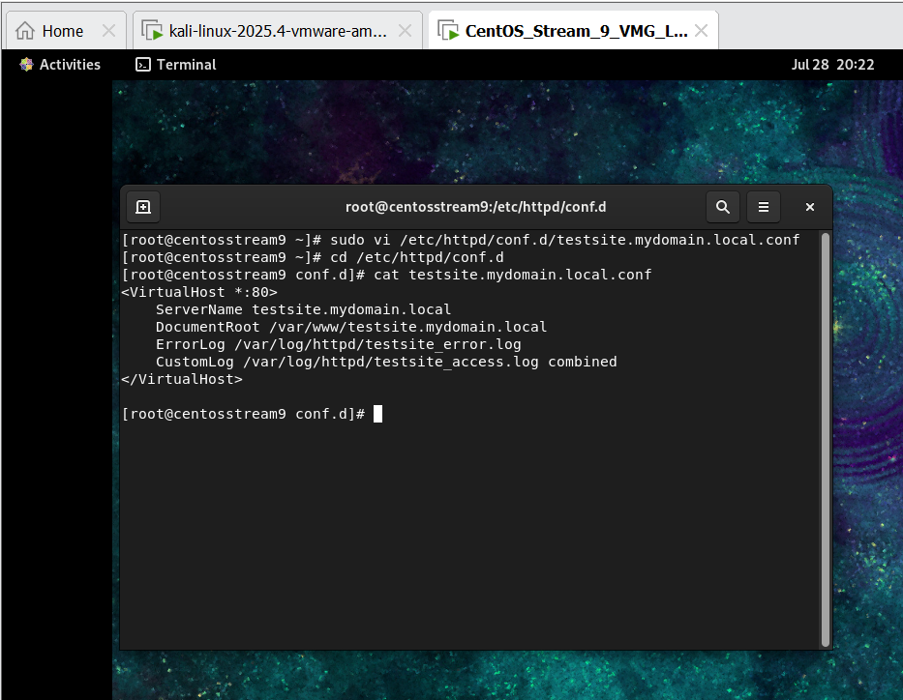

```bash
# Create document root and a simple index page
mkdir -p /var/www/testsite.mydomain.local
echo "Testsite Ready..." | sudo tee /var/www/testsite.mydomain.local/index.html
```

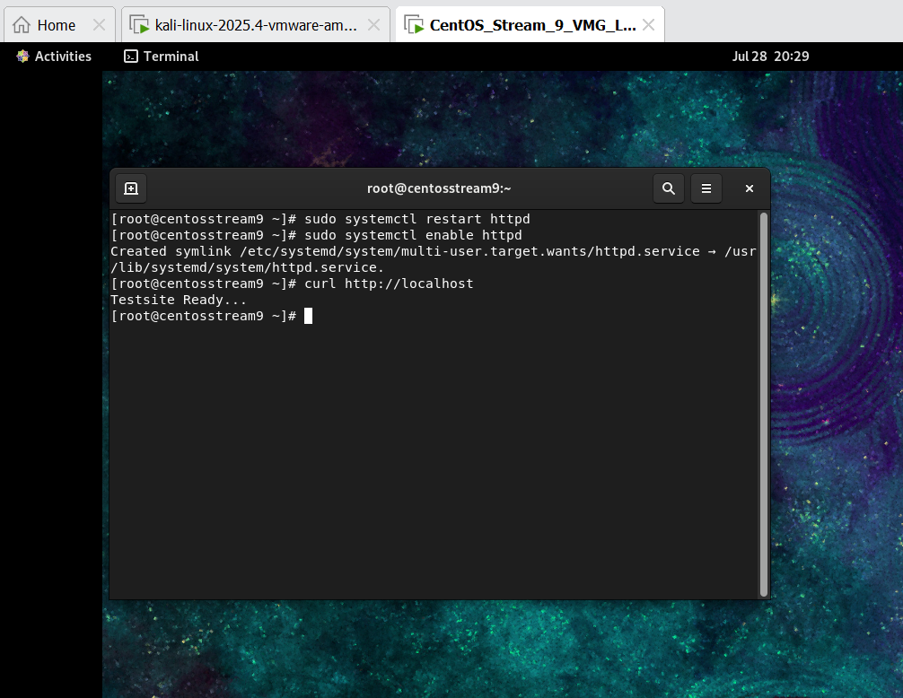

```bash
# Symlink /Reports into the website
ln -s /Reports /var/www/testsite.mydomain.local/reports

# Add hostname to /etc/hosts
vi /etc/hosts
# Add: 127.0.0.1 testsite.mydomain.local

# Start and enable Apache
systemctl start httpd
systemctl enable httpd

# Test in browser
firefox http://testsite.mydomain.local
```

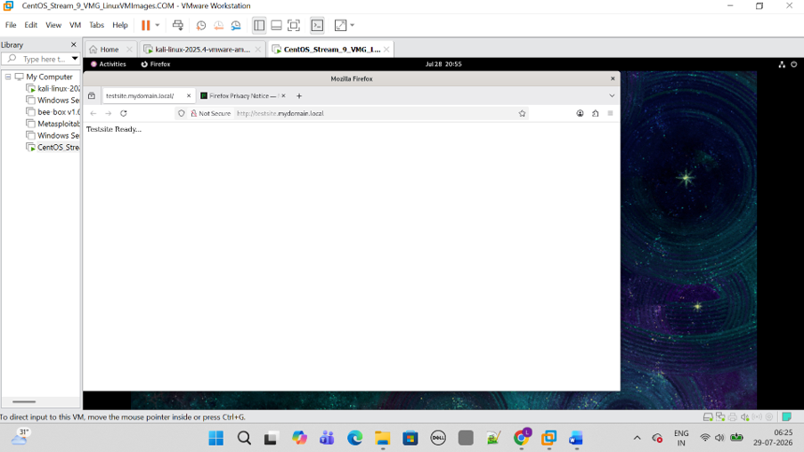

---

## Step 3 — Firewall & SELinux Configuration

### 3.1 Open Required Ports

```bash
firewall-cmd --permanent --zone=public --add-port=2222/tcp
firewall-cmd --permanent --zone=public --add-port=80/tcp
firewall-cmd --permanent --zone=public --add-port=20/tcp
firewall-cmd --permanent --zone=public --add-port=21/tcp
firewall-cmd --reload
```

### 3.2 Enable SELinux Enforcing Mode

```bash
setenforce 1
getenforce   # Should output: Enforcing
```

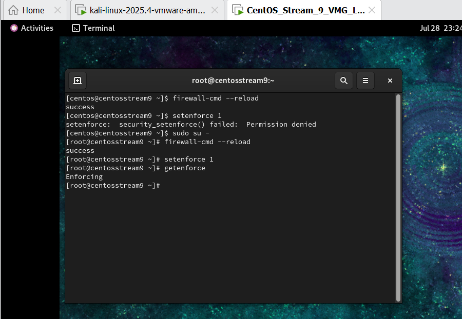

### 3.3 Set SELinux Context for /Reports

```bash
# Allow Apache to serve files from /Reports
chcon unconfined_u:object_r:httpd_sys_content_t:s0 /Reports/
touch /Reports/101.log
chcon unconfined_u:object_r:httpd_sys_content_t:s0 /Reports/101.log
```

### 3.4 Verify Access in Browser

```bash
firefox http://testsite.mydomain.local/reports
```

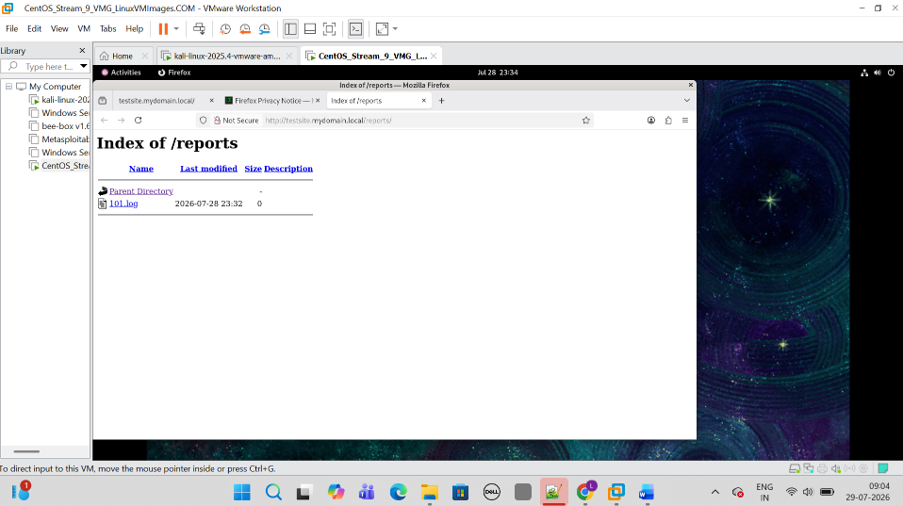

---

## Step 4 — FTP & SSH Service Setup

### 4.1 Configure vsftpd (FTP)

```bash
vi /etc/vsftpd/vsftpd.conf
# Set: local_enable=NO
# Set: write_enable=NO

systemctl start vsftpd
systemctl enable vsftpd
```

### 4.2 Start SSH Service

```bash
systemctl start sshd
systemctl enable sshd
```

### 4.3 Check CentOS IP and Verify Connectivity from Kali

```bash
# On CentOS
ip a

# On Kali — confirm packets reach CentOS
ping <CentOS_IP>
```

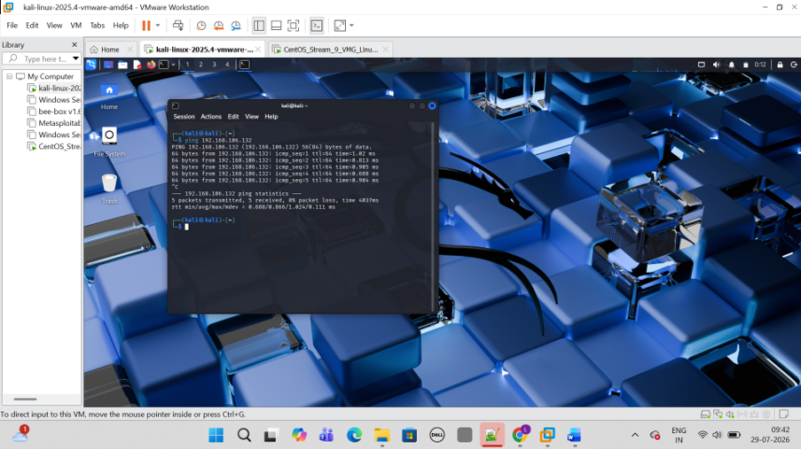

---

## Step 5 — SSH Hardening

### 5.1 Change SSH Port to 2222

```bash
vi /etc/ssh/sshd_config
# Find:  #Port 22
# Change to:  Port 2222

# Restart SSH to apply
systemctl restart sshd
systemctl status sshd   # Should show: active (running)

# Verify SELinux mode
getenforce   # Should show: Enforcing
```

### 5.2 Add Port 2222 to SELinux Policy

```bash
semanage port -a -t ssh_port_t -p tcp 2222
systemctl restart sshd
systemctl status sshd
```

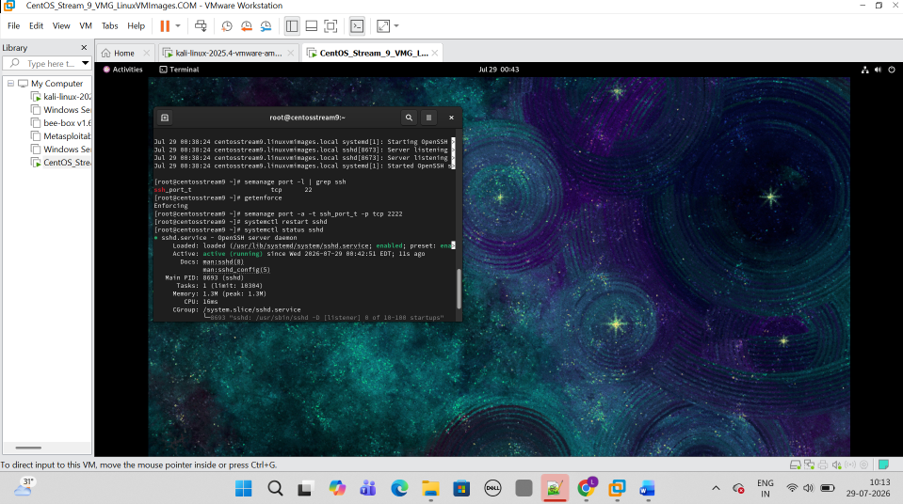

### 5.3 Verify SELinux Recognizes Port 2222

```bash
semanage port -l | grep ssh
```

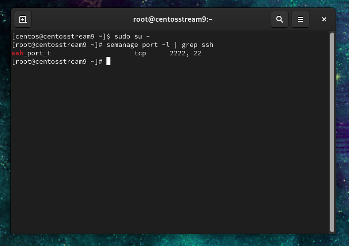

### 5.4 Simulate Failed Logins from Kali

```bash
# Run from Kali terminal — these users do not exist on CentOS
ssh -p 2222 ramu@<CentOS_IP>
ssh -p 2222 testuser@<CentOS_IP>
ssh -p 2222 ubuntu@<CentOS_IP>
```

### 5.5 Monitor Failed Logins on CentOS

```bash
watch 'tail /var/log/secure | grep ssh | grep -i FAILED'
```

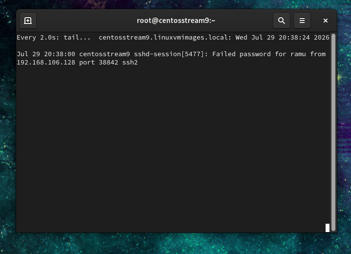

---

## Step 6 — Automate Log Collection

### 6.1 Create the Script

```bash
vi /root/b_track_ssh_daily
# Paste contents from scripts/b_track_ssh_daily.sh
```

### 6.2 Schedule Daily Execution

```bash
crontab -e
# Press i for insert mode, then add:
@daily /root/b_track_ssh_daily
```

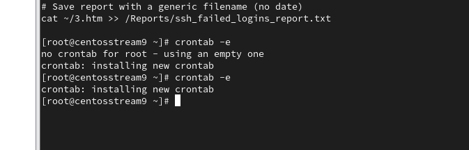

### 6.3 Make Executable

```bash
chmod +x /root/b_track_ssh_daily
```

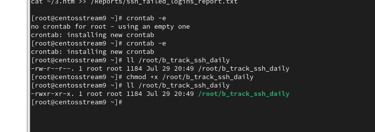

### 6.4 Run Manually to Test

```bash
/root/b_track_ssh_daily
```

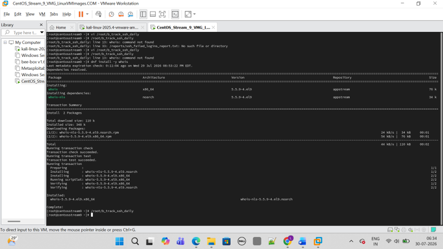

---

## Step 7 — Automated IP Blocking

### 7.1 Create the Blocking Script

```bash
vi /root/protect_ssh
# Paste contents from scripts/protect_ssh.sh

# Make executable and run
chmod +x /root/protect_ssh
/root/protect_ssh
```

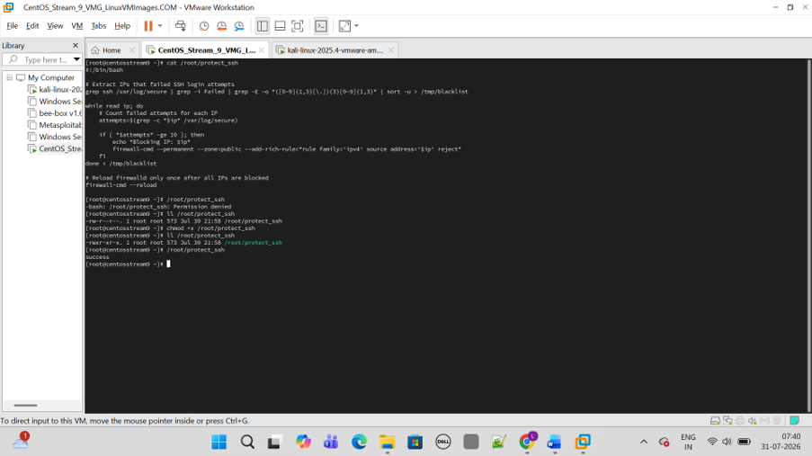

### 7.2 Start & Enable Firewall

```bash
systemctl start firewalld
systemctl enable firewalld
```

### 7.3 Generate Failed Attempts from Kali and Verify Firewall Rules

Run failed SSH attempts from Kali, then on CentOS verify the IPs are blocked:

```bash
firewall-cmd --list-rich-rules
# Should show: rule family="ipv4" source address="<attacker_IP>" reject
```

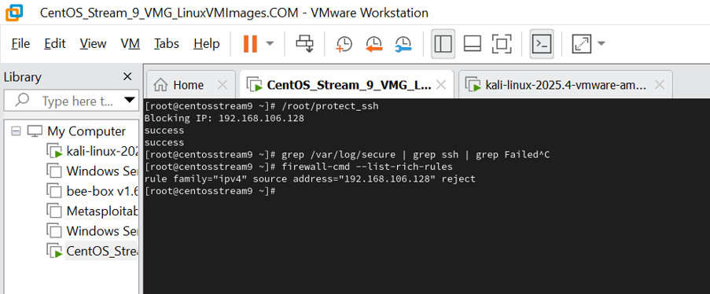

### 7.4 Test Blocked Access from Kali

```bash
ssh -p 2222 testuser@<CentOS_IP>
# Expected: ssh: connect to host <IP> port 2222: Connection refused
```

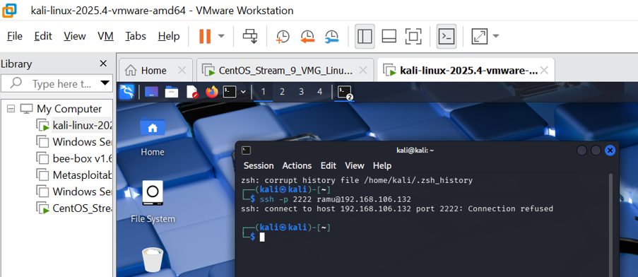

### 7.5 View Full Report in Browser

```bash
firefox http://testsite.mydomain.local/reports/
```

Click on `ssh_failed_logins_report.txt` to view the full list of blocked IPs.

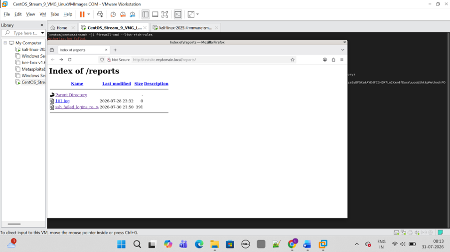

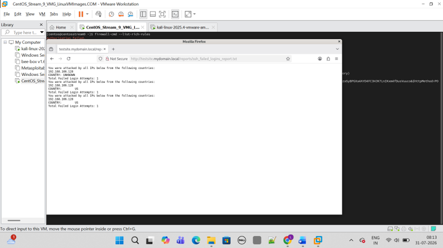

---

## ✅ Verification Checklist

- [ ] CentOS and Kali VMs can ping each other
- [ ] SSH accessible on port 2222 from Kali
- [ ] Failed logins appear in `/var/log/secure`
- [ ] `b_track_ssh_daily` generates report in `/Reports/`
- [ ] Cron job scheduled with `@daily`
- [ ] `protect_ssh` blocks IPs in firewalld after 6+ attempts
- [ ] Blocked IP gets `Connection refused` from Kali
- [ ] Report viewable at `testsite.mydomain.local/reports/`
